 

 

  

 

## About

I'm a software engineer who builds real-world applications. Thousands of people use what I ship, and that shapes how I work: I care about products that are reliable, fast, and simple enough for anyone to pick up.

I take an idea from first sketch to a live product in people's hands, then keep improving it based on what users tell me.

 

## Shipped Products

<!-- APPS:START -->
<table>
  <tr>
    <td width="33%" align="center" valign="top">
      
      <h3>Mezgebe Sibhat</h3>
      
መዝገበ ስብሐት

      
Offline audio lessons for traditional Abinet education: Qidase, Wereb, Kidan and more. Download once, learn anywhere.

      
      
        
      
    </td>
    <td width="33%" align="center" valign="top">
      
      <h3>Mahlet Ze-Kidus Yared</h3>
      
ማሕሌት ዘቅዱስ ያሬድ

      
The complete Mahlet and Wazema liturgy in Ge'ez: 100+ feast-day services, organized by Ethiopian month and feast.

      
      
        
      
    </td>
    <td width="33%" align="center" valign="top">
      
      <h3>Mezmure Dawit</h3>
      
መዝሙረ ዳዊት ወ ግጻዌ

      
The Psalms of David and Getsawe in one app, with a built-in audio player for reading and listening.

      
      
        
      
    </td>
  </tr>
</table>
<!-- APPS:END -->

 

## Tech Stack

 

 

 

### Let's build something great

I'm open to engineering roles, collaborations and ambitious projects.

  

